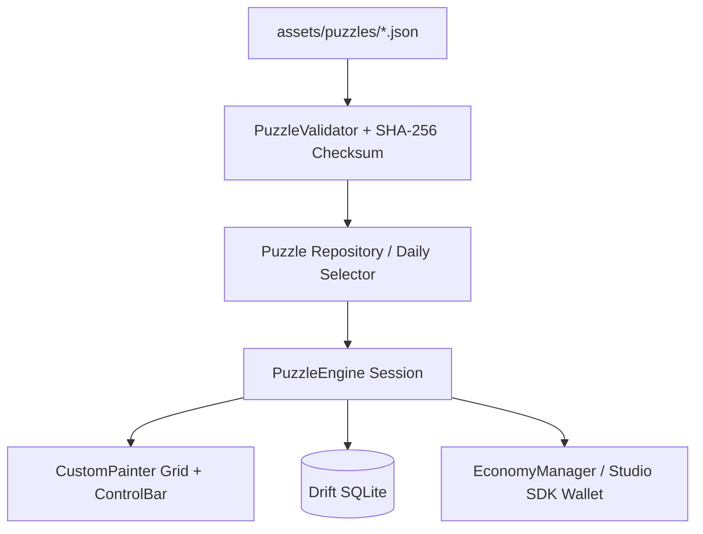

# Nonogram — Complete Game Guide

> **Türkçe sürüm:** [GAME_GUIDE.tr.md](GAME_GUIDE.tr.md)

This document provides a comprehensive overview of **how to play, game mechanics & engine logic, content creation pipeline, and how to build & run** the game. For the technical architecture overview, see [architecture.md](architecture.md); for the JSON content schema, see [content_format.md](content_format.md); and for current verification status, see [project_status.md](project_status.md).

> Note: The repository README contains a "Recovery note"; builds and tests are preserved from historic records and have not all been re-executed in this environment. For known open items, see [project_status.md](project_status.md) (B1–B7).

---

## 1. What is Nonogram (Picross)?

Nonogram is a logic puzzle where players deduce which cells in a rectangular grid should be **filled** or left empty based on numeric clues placed along the borders. Filling the correct pattern reveals hidden pixel artwork. Every puzzle features a **guaranteed unique logical solution** — guessing is never required.

---

## 2. How to Play

### 2.1 Reading Grid Clues
- Numbers to the left of each row indicate the lengths of consecutive filled blocks in that row (left-to-right).
- Numbers above each column indicate the lengths of consecutive filled blocks in that column (top-to-bottom).
- Multiple numbers mean there is **at least one empty cell** between each consecutive block.

*Example (5×5, "Cat"):* Row clues `[1, 1]`, `[5]`, `[2, 2]`, `[3]`, `[1]`. The row with clue `[5]` is completely filled. A row with `[1, 1]` contains 1 filled cell, at least 1 empty space, and 1 filled cell.

### 2.2 In-Game Tools (Control Bar)
| Tool | Function |
| :-- | :-- |
| **Fill** | Marks the cell as filled (colored block) |
| **Cross (X)** | Places an 'X' marking known empty cells (assists deduction; doesn't affect win condition) |
| **Erase** | Clears the cell back to empty |
| **Undo / Redo** | Reverts or repeats recent moves |
| **Precision Mode** | Activates expanded touch targets along row/column axes |
| **Hint** | Spends 1 hint to reveal a guaranteed correct cell (never contradicts solution) |

### 2.3 Touch & Gestures
- Single tap: updates the cell based on the selected tool.
- **Drag-to-fill:** Uses Bresenham interpolation to prevent skipping cells during rapid swipe gestures.
- **Axis locking:** Drag operations snap horizontally or vertically to avoid accidental diagonal jitter.
- **Zoom & Pan:** `InteractiveViewer` supports pinch-to-zoom and panning on larger grids (e.g., 15×15).
- Highlight lines follow the active row/column, and bold divider lines separate 5×5 cell blocks.

### 2.4 Solving Strategies
1. **Full-line clues:** When clues plus required single-space separators equal the grid width, all cell positions are immediately known.
2. **Overlap deduction:** In a 10-cell row with a clue of `[7]`, the center 4 cells must be filled regardless of alignment.
3. **Cross off completed lines:** Mark empty cells with X as soon as blocks are satisfied to avoid accidental mistakes.
4. **Row ↔ Column pivoting:** Deducing cells in one orientation unlocks clues in the perpendicular direction.

---

## 3. Game Modes & Features

| Feature | Description |
| :-- | :-- |
| **Collections** | Categorized puzzle packs: Animals, Nature, Food, Objects, Symbols across 5×5, 10×10, and 15×15 dimensions. |
| **Daily Nonogram** | Calendar-seeded deterministic daily challenge with continuous streak tracking. |
| **Relax Mode** | Disables 3-mistake failure penalties; solve at your own pace. |
| **Tutorial** | Step-by-step interactive onboarding demonstrating clue reading, X-marking, and overlap logic. |

**Mistake Policy:** In Standard Mode, placing an incorrect fill adds a mistake strike; **3 mistakes** fails the level (disabled in Relax Mode).

**Star Rating System (1–3 ⭐):**
- 0 mistakes and 0 hints used → **3 ⭐**
- ≤1 mistake and ≤2 hints used → **2 ⭐**
- Otherwise → **1 ⭐**

**Rewards:** Completing a puzzle awards `stars × 15` Coins. Upon victory, the solved **pixel artwork** is animated with its custom color palette (respects Reduced Motion setting).

**Daily Login Rewards:** Grants `50 (LiveOps customizable) + min(streak, 7) × 10` Coins, with 2 hints granted every 3rd consecutive day (1 hint on other days).

**Starter Content (20 Puzzles):**
- **Animals:** Cat (5×5), Duck (5×5), Penguin (10×10), Elephant (15×15)
- **Nature:** Pine Tree (5×5), Mushroom (5×5), Tulip (10×10), Mountain Peak (15×15)
- **Food:** Apple (5×5), Coffee Mug (10×10), Ice Cream (15×15)
- **Objects:** Key (5×5), Sword (10×10), Castle (15×15)
- **Symbols:** Heart (5×5), Star (5×5), Music Note (10×10), Crescent Moon (15×15)
- **Tutorial:** First Step (5×5), Smile (5×5)

---

## 4. Navigation & Screens

Home Screen → Collections Screen → Category Details → **Puzzle Board** (`/puzzle/:puzzleId`). Additional screens: **Shop & Inventory**, **Settings**, **Statistics** (total solved, best times, stars, streaks), and **Tutorial**.

**Settings:** 4 themes (Classic Paper, Midnight OLED, Ocean, High Contrast), Relax Mode toggle, Precision Input mode, Haptics toggle, Reduced Motion.

---

## 5. Engine Architecture & Logic



- **`lib/engine/` (Zero-dependency pure Dart):**
  - `solver/`: **`LineSolver`** (1D line overlap deduction) and **`NonogramSolver`** (backtracking uniqueness verifier).
  - `generator/`: Clue generation from binary solutions.
  - `validator/`: Validates dimensions, clue sums, solution matching, and SHA-256 checksums.
  - `game/puzzle_engine.dart`: Session state, undo/redo stacks, hints, and mistake rules.
- **Puzzle Format:** JSON schema specifying dimensions, row/column hints, binary row-major encoded solution string, difficulty, reveal palette, and SHA-256 checksum. See [content_format.md](content_format.md).
- **Data Integrity:** Checksum = `sha256("id:width:height:rowHints:colHints:encodedSolution")`. Corrupted files fail validation at startup.

---

## 6. Monetization

- **Ads Free (Lifetime)**: Permanent non-consumable IAP (`com.antigravity.nonogram.ads_free`) with offline cached entitlement.
- **Interstitials**: Natural game breaks only (minimum **90-second cooldown**). Never shown mid-puzzle.
- **Rewarded Ads**: Optional player-initiated ads to earn bonus hints or coins.
- In the current repository state, IAP and Ad networks use **mock implementations** ([project_status.md](project_status.md) B1). See [monetization.md](monetization.md) for production wiring.

---

## 7. Setup & Execution

**Prerequisites:** Flutter SDK (Dart `^3.13.4`), Android Studio or Xcode, access to `studio_core_sdk` (GitHub).

```bash
git clone https://github.com/denogames/nonogram.git
cd nonogram
flutter pub get
dart run build_runner build      # Generates Drift database classes (committed)
flutter test                     # Runs unit & widget test suite
flutter run                      # Launch on emulator/device
```

---

## 8. Content Tool CLI

A command-line tool is included for creating and verifying puzzle packs:

```bash
# Validate existing pack (schema, checksum, uniqueness)
dart run bin/content_tool.dart validate assets/puzzles/animals.json

# Compile and verify starter collections
dart run bin/content_tool.dart build-packs
```

Puzzles with ambiguous multiple solutions are automatically rejected by `NonogramSolver`.

---

## 9. Troubleshooting

| Issue | Resolution |
| :-- | :-- |
| Dependency failure on `studio_core_sdk` | Check GitHub credentials and SSH/HTTPS tokens. |
| Database generation error | Run `dart run build_runner build --delete-conflicting-outputs`. |
| Accidental mis-clicks on small screens | Enable Precision Mode or pinch to zoom. |
| Level fails due to 3 mistakes | Switch on Relax Mode in Settings. |
