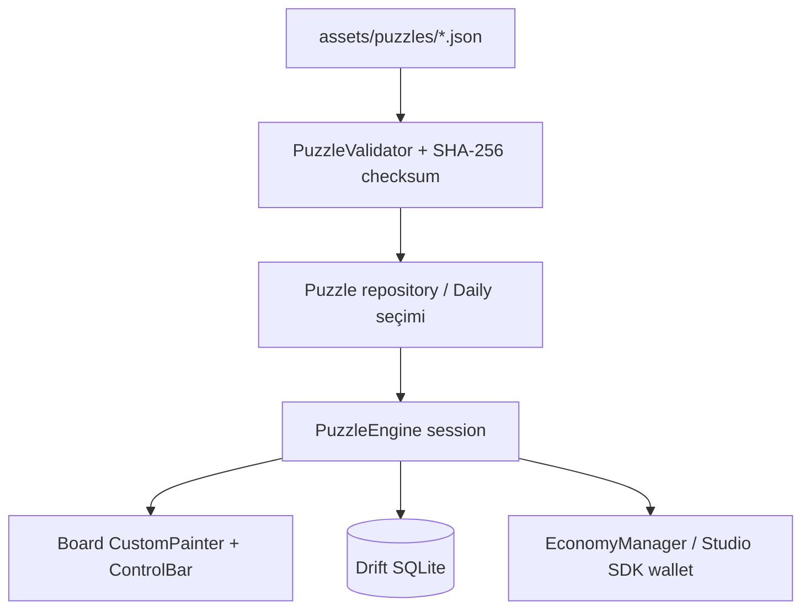

# Nonogram — Oyun Rehberi

> **English version:** [GAME_GUIDE.en.md](GAME_GUIDE.en.md)


Bu belge oyunun **nasıl oynandığını, nasıl çalıştığını, içerik/bulmaca sürecini ve nasıl çalıştırılacağını** anlatır. Teknik özet için [README.md](../README.md), mimari için [architecture.md](architecture.md), içerik formatı için [content_format.md](content_format.md), güncel durum için [project_status.md](project_status.md) belgelerine bakın.

> Dikkat: Projenin README'sinde "Recovery note" bulunur; testlerin/build'in çalıştırılması bu rehberde doğrulanmış kabul edilmez. Bilinen açık konular için [project_status.md](project_status.md) (B1–B7).

---

## 1. Nonogram (Picross) nedir?

Izgara kenarlarındaki sayı ipuçlarına bakarak hücreleri **boyayarak** gizli bir piksel resmi ortaya çıkardığınız mantık bulmacasıdır. Tahmin gerekmez; her bulmacanın **tek bir mantıksal çözümü** vardır (oyun içeriği bu şekilde doğrulanır).

---

## 2. Nasıl oynanır?

### 2.1 İpuçlarını okumak
- Satırın solundaki sayılar o satırdaki **ardışık dolu blokların uzunluklarını** (soldan sağa) verir.
- Sütunun üstündeki sayılar aynı şekilde yukarıdan aşağıya bloklardır.
- Bloklar arasında **en az bir boş hücre** bulunur.

Örnek (5×5, "Cat"): satır ipuçları `[1,1] [5] [2,2] [3] [1]`, sütun ipuçları `[3] [4] [2,1] [4] [3]`. `[5]` olan satır tamamen doludur; `[1,1]` ise "1 dolu, boşluk, 1 dolu" demektir.

### 2.2 Araçlar (kontrol çubuğu)
| Araç | İşlev |
| :-- | :-- |
| **Fill** | Hücreyi doldurur |
| **Cross (X)** | "Burası kesin boş" işareti (sadece not, çözümü etkilemez) |
| **Erase** | Hücreyi temizler |
| **Undo / Redo** | Geri al / yinele |
| **Precision Mode** | Satır/sütun için genişletilmiş dokunma şeritleri |
| **Hint** | Bir ipucu harcar, doğru bir hücreyi gösterir (asla çelişmez) |

### 2.3 Dokunma ve sürükleme
- Tek dokunuş: hücreyi seçili araca göre değiştirir.
- **Sürükle-doldur:** Bresenham interpolasyonuyla hızlı kaydırmada hücre atlamaz.
- **Eksen kilidi:** Sürükleme yatay ya da dikey kilitlenir (çapraz kayma olmaz).
- **Zoom/Pan:** 15×15 gibi büyük tahtalarda iki parmakla yakınlaştırma ve kaydırma.
- Aktif satır/sütun ve ipucu başlıkları vurgulanır; her 5 hücrede kalın ayırıcı çizgiler vardır.

### 2.4 Çözüm stratejileri
1. **Tam dolu ipucu:** Bir satırın ipuçları + boşluklar genişliğe eşitse (ör. `[5]` / 5 hücre) tamamı bellidir.
2. **Örtüşme (overlap):** Genişlik 10, ipucu `[7]` ise ortadaki 4 hücre kesin doludur.
3. **Boş hücreleri X'leyin:** Tamamlanan blokların yanlarını işaretleyin.
4. **Satır ↔ sütun geçişi:** Bir yönden çıkan kesin hücreler diğer yönü açar.
5. **Kenardan başlayın:** İlk/son blok kenara dayanıyorsa konumu sabitlenir.

---

## 3. Oyun modları ve özellikler

| Özellik | Açıklama |
| :-- | :-- |
| **Collections** | Kategoriler: Animals, Nature, Food, Objects, Symbols. Boyutlar 5×5, 10×10, 15×15. |
| **Daily Nonogram** | Tarihe bağlı deterministik günlük bulmaca, seri (streak) takibi |
| **Relax Mode** | Hata cezası yok; kendi hızınızda çözün |
| **Tutorial** | İpucu okuma, X işareti ve örtüşme çıkarımını öğreten etkileşimli rehber + alıştırma bulmacası |

**Hata politikası:** Normal modda yanlış hücre doldurursanız hata sayılır; **3 hata** bulmacayı başarısız yapar (Relax Mode'da kapalı).

**Yıldız sistemi (1–3 ⭐):**
- Hatasız ve ipucusuz → **3 ⭐**
- ≤1 hata ve ≤2 ipucu → **2 ⭐**
- Aksi halde → **1 ⭐**

**Coin ödülü:** Bulmaca tamamlayınca `yıldız × 15` coin. Tamamlayınca, çözülen **piksel resim** renk paletiyle animasyonla ortaya çıkar (Reduced Motion ayarı vardır).

**Günlük giriş ödülü:** `50 (LiveOps ile değiştirilebilir) + min(seri,7) × 10` coin; seri her 3. günde 2, diğer günlerde 1 ipucu verir.

**İçerik (başlangıç paketleri, 20 bulmaca):**
- Animals: Cat, Duck, Penguin, Elephant
- Nature: Pine Tree, Mushroom, Tulip, Mountain Peak
- Food: Apple, Coffee Mug, Ice Cream
- Objects: Key, Sword, Castle
- Symbols: Heart, Star, Music Note, Crescent Moon
- Tutorial: First Step, Smile

---

## 4. Ekranlar

Home → Collections → Kategori detayı → **Puzzle** (`/puzzle/:puzzleId`). Ayrıca: **Shop**, **Settings**, **Statistics** (çözülen sayısı, en iyi süreler, yıldızlar, seri), **Tutorial**.

**Ayarlar:** 4 tema (Classic Paper, Midnight, Ocean, High Contrast), Relax Mode, Precision Input, haptik, Reduced Motion.

---

## 5. Oyun nasıl çalışıyor? (Mantık)



- **`lib/engine/` (saf Dart, Flutter bağımsız):**
  - `solver/`: **LineSolver** (tek satır çıkarımı) ve **NonogramSolver** (geri izlemeli, benzersizlik doğrulama).
  - `generator/`: Çözümden ipucu çıkarımı ve paket derleme.
  - `validator/`: Boyut, ipucu tutarlılığı, çözüm uyumu, tek çözüm, SHA-256 bütünlüğü.
  - `game/puzzle_engine.dart`: Oturum çalışma zamanı; araçlar, undo/redo, ipucu, hata politikası, serileştirme.
- **Bulmaca formatı:** `puzzleId`, `width/height`, `rowHints/columnHints`, `encodedSolution` (satır-major `1`/`0`), `difficulty`, `colorPalette`, `checksum` vb. Ayrıntı: [content_format.md](content_format.md).
- **Bütünlük:** Checksum = `sha256("id:width:height:rowHints:colHints:encodedSolution")`. Bozuk paket oyuncuya ulaşmaz.
- **Ekonomi/IAP:** `EconomyManager`, `IapManager`, `AdManager`; `studio_core_sdk` cüzdanı ile coin/ipucu senkronu.

---

## 6. Monetizasyon

- **Ads Free** (non-consumable): `com.antigravity.nonogram.ads_free`; çevrimdışı önbelleğe alınmış hak, satın almayı geri yükleme.
- Interstitial reklamlar oyun içinde asla gösterilmez; aralarında en az **90 sn**.
- Rewarded reklam: bonus ipucu/coin.
- Mevcut durumda IAP/reklamlar **mock**'tur ([project_status.md](project_status.md) B1). Ayrıntı: [monetization.md](monetization.md).

---

## 7. Kurulum ve çalıştırma

**Gereksinimler:** Flutter SDK (Dart `^3.13.4`), Android Studio veya Xcode, `studio_core_sdk` (GitHub) erişimi.

```bash
git clone https://github.com/denogames/nonogram.git
cd nonogram
flutter pub get
dart run build_runner build      # Drift kodu (zaten commit'li)
flutter test
flutter run                      # cihaz/emülatör
```

Release build'ler: `flutter build apk --release` / `flutter build ios --release`. (Android release şu an debug imzalı, üretimden önce imzalama gerekir — B6.)

---

## 8. Yeni bulmaca ekleme / içerik aracı

```bash
# Bir paketi doğrula (şema, checksum, tek çözüm)
dart run bin/content_tool.dart validate assets/puzzles/animals.json

# Başlangıç paketlerini derle ve doğrula
dart run bin/content_tool.dart build-packs
```

Süreç: ASCII piksel resim hazırla → ipuçları üretilir → solver tek çözümü doğrular → checksum hesaplanır → JSON `assets/puzzles/` altına yazılır. Belirsiz (çok çözümlü) bulmacalar reddedilir. `pubspec.yaml` `assets/puzzles/` klasörünü paketler.

---

## 9. Testler

8 Dart test dosyası: line solver, solver/benzersizlik, engine oturumu, dokunma eşleme, günlük tutarlılık, veritabanı, entitlement, widget testleri. Çalıştırma: `flutter test`.

---

## 10. Sorun giderme

| Sorun | Çözüm |
| :-- | :-- |
| Paket çözümlenemiyor | `studio_core_sdk` GitHub erişimini kontrol edin |
| Drift hataları | `dart run build_runner build --delete-conflicting-outputs` |
| Büyük tahtada yanlış dokunma | Precision Mode açın veya zoom yapın |
| Hata yüzünden bitiyor | Settings → Relax Mode |
